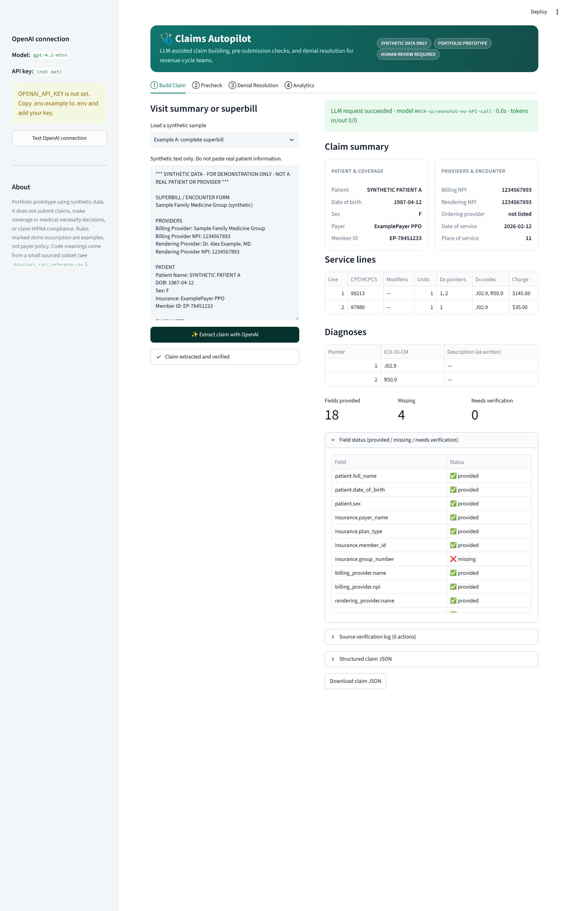
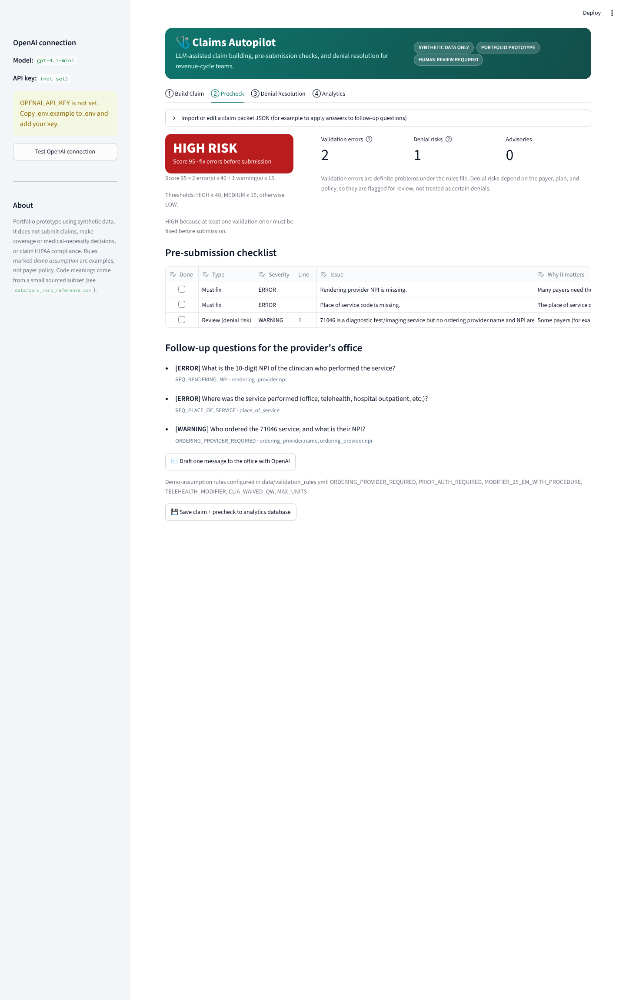
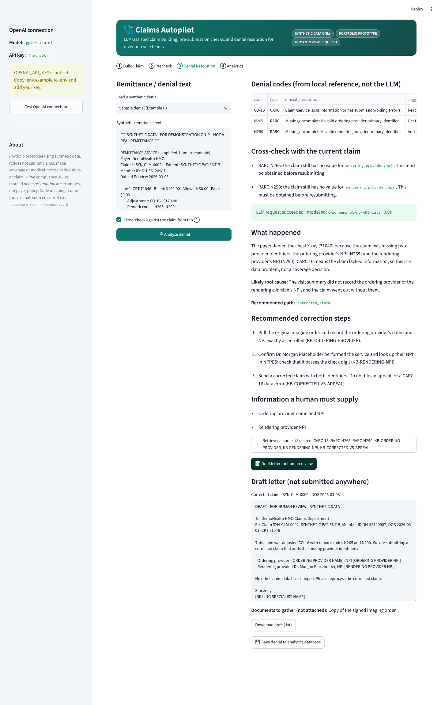

# Claims Autopilot

**An LLM-powered healthcare claims assistant for revenue-cycle teams: build claims from visit notes, catch problems before submission, and resolve denials.**

> ⚠️ **Portfolio prototype. Synthetic data only.** It does not submit claims, make coverage or
> medical-necessity decisions, or claim HIPAA compliance or production readiness. Every output is
> meant for human review.



| | |
|---|---|
|  |  |

<sub>Screenshots were captured without an API key, with the OpenAI call replaced by canned responses (the
status bar shows `MOCK-screenshot-no-API-call`). With a real key, the same screens show the live model name and token counts.</sub>

---

## What it does

| Feature | What happens | Where |
|---|---|---|
| **1. Intelligent Claim Builder** | An OpenAI model reads a synthetic superbill or visit note and returns a claim that **must match a Pydantic schema** (OpenAI Structured Outputs). A deterministic verifier then checks every value against the source text. Unsupported values are removed, clearly labeled values the model missed are restored, and each field is marked *provided*, *missing*, or *needs verification*. | `extractor.py`, `source_parser.py` |
| **2. Pre-Submission Denial Prevention** | Configurable YAML rules check required fields, formats (including the NPI check digit), diagnosis pointers, units, and code-specific requirements. **Validation errors** (definitely wrong under the rules) are kept separate from **denial risks** (payer-dependent). Each issue explains why it matters and asks a targeted follow-up question. Risk is LOW/MEDIUM/HIGH with a visible score formula. | `validator.py`, `questioner.py`, `data/validation_rules.yml` |
| **3. Denial Resolution Copilot** | CARC/RARC codes are pulled from remittance text and looked up in a **locally stored, sourced reference table** (never the model's memory). Relevant guidance is retrieved (RAG) and the LLM explains the denial, plans the fix, and drafts a correction or appeal letter with `[PLACEHOLDERS]` for missing evidence. Identifiers the draft invents are flagged. Nothing is ever submitted. | `denial.py`, `retrieval.py`, `generator.py` |
| **4. Analytics** | Claims, precheck issues, and denials are stored in **SQLite** and analysed with plain **SQL** (clean-claim rate, top issues, issues by payer, denial codes, dollars on hold). | `database.py`, `sql/*.sql` |
| **Evaluation** | 28 labeled synthetic claims and 10 synthetic denials, with a script that measures extraction accuracy, defect detection, and code extraction. | `evaluation.py`, `scripts/evaluate.py`, [`docs/EVALUATION.md`](docs/EVALUATION.md) |

## Architecture

```
visit note ──► OpenAI Structured Outputs ──► ClaimData (Pydantic)
                                                  │
                     source_parser (regex) ──►  verify_against_source
                                                  │  (remove invented values, restore missed
                                                  ▼   labeled values, mark field status)
                                             ClaimPacket ──► validator (YAML rules) ──► risk + checklist + questions
                                                  │                                            │
remittance text ──► CARC/RARC regex ──► reference CSV lookup ──► BM25 retrieval ──► OpenAI ──► explanation, steps, letter
                                                  │                                            │
                                                  └──────────────► SQLite + SQL analytics ◄─────┘
```

**Why this design (in plain words)**
- **The LLM reads; code checks.** Language models are good at understanding messy notes but can drop or invent values. Our own code double-checks every identifier against the original text, so the final claim contains only what was actually written.
- **Structured Outputs + Pydantic.** The model has to answer in our exact JSON shape: insurance is an object with separate `payer_name` and `member_id`, NPIs are strings, and every service line has `units`, `modifiers`, and `diagnosis_pointers`. This fixes the "insurance came back as a dict/string" problem.
- **Rules in YAML, not code.** Billing teams can change a rule without touching Python. Rules that are simplifications are marked `demo_assumption: true`.
- **RAG instead of training.** The app was **not trained or fine-tuned**. It retrieves passages from local files at run time and gives them to the model, and the model must cite which passages it used.
- **BM25 instead of a vector database.** The knowledge base is about 50 passages. A 30-line keyword ranker is deterministic, testable, and needs no extra services. Code meanings never depend on ranking: they are exact table lookups.

### Repository layout

```
claims-autopilot/
├── app.py                         Streamlit UI (4 tabs)
├── pyproject.toml                 package config: `pip install -e .` makes imports work everywhere
├── requirements.txt               dependencies (+ `-e .` to install this package)
├── .env.example                   copy to .env and add your key
├── src/claims_autopilot/
│   ├── config.py                  env vars, paths, logging
│   ├── llm.py                     the only OpenAI code: Structured Outputs + clear error messages + API check
│   ├── schemas.py                 Pydantic models
│   ├── extractor.py               Feature 1 (LLM + verifier)
│   ├── source_parser.py           deterministic reading of labeled values (verifier, not a replacement)
│   ├── validator.py               Feature 2 rules + risk score
│   ├── questioner.py              follow-up questions, checklist, optional LLM message to the office
│   ├── denial.py                  Feature 3 code extraction, lookup, LLM analysis
│   ├── retrieval.py               BM25 retrieval over reference + guidance (RAG)
│   ├── generator.py               letter drafting + invented-identifier check
│   ├── database.py, sql/          SQLite schema and named analytics queries
│   └── evaluation.py              metrics on the labeled synthetic set
├── data/
│   ├── sample_superbill_good.txt          Example A
│   ├── sample_superbill_incomplete.txt    Example B
│   ├── sample_denial.txt
│   ├── carc_rarc_reference.csv            sourced code subset (see Data sources)
│   ├── denial_knowledge_base.md           project-written guidance passages for RAG
│   ├── validation_rules.yml
│   ├── synthetic_claims/                  28 claims + ground_truth.json
│   └── synthetic_denials/                 10 denials + ground_truth.json
├── scripts/  check_openai.py · evaluate.py · seed_database.py · generate_synthetic_data.py
├── tests/    test_extractor.py · test_validator.py · test_denial.py · test_app.py
├── docs/     EVALUATION.md · DATA_SOURCES.md · DEMO_SCRIPT.md · screenshots/
└── outputs/  local database and evaluation JSON (git-ignored)
```

Changes from the suggested layout, and why: `source_parser.py` (the verifier) and `retrieval.py` (RAG) are their own modules so each has one job. `database.py` + `sql/` add the analytics layer. `evaluation.py` + `scripts/` make the metrics reproducible. `pyproject.toml` replaces any `sys.path` tricks.

## Setup (about 10 minutes)

Requirements: Python 3.10+ and an OpenAI API key with credits.

```bash
git clone https://github.com/<your-username>/claims-autopilot.git
cd claims-autopilot

python -m venv .venv
# macOS/Linux:
source .venv/bin/activate
# Windows (PowerShell):
.venv\Scripts\Activate.ps1

pip install -r requirements.txt      # also installs this project as the `claims_autopilot` package
cp .env.example .env                 # Windows: copy .env.example .env
```

Edit `.env`:

```
OPENAI_API_KEY=sk-...your key...
OPENAI_MODEL=gpt-4.1-mini            # any model your project can use that supports Structured Outputs
```

### Verify API access before opening the app

```bash
python scripts/check_openai.py
```

It checks three things, in order, and stops at the first failure with a fix:

1. **configuration**: key present, not the placeholder, looks like `sk-...`
2. **model_access**: `OPENAI_MODEL` is visible to this key (no cost)
3. **structured_output_call**: one tiny request succeeds (proves quota and schema support)

| Error you might see | Meaning | Fix |
|---|---|---|
| `authentication` (401) | Key wrong or revoked | Create a new key, update `.env`, restart |
| `insufficient_quota` | No usable credit on the key's org/project | Check Billing; credits must be on the same project as the key; wait a few minutes after adding credits |
| `rate_limit` (429) | Too many requests | Wait and retry |
| `model_access` | Model not enabled for this project | Change `OPENAI_MODEL` |
| `bad_request` mentioning `response_format` | Model does not support Structured Outputs | Use gpt-4o-mini, gpt-4.1-mini, or newer |

The app never fakes a result. If a call fails it shows the error and produces no claim.

### Run

```bash
streamlit run app.py          # opens http://localhost:8501
python -m pytest -q           # 40 tests, no API key needed (OpenAI is mocked)
python scripts/seed_database.py   # load synthetic data into SQLite for the Analytics tab
python scripts/evaluate.py        # metrics without API calls
python scripts/evaluate.py --llm  # + live LLM extraction accuracy on all 28 claims (a few cents)
RUN_LIVE_TESTS=1 python -m pytest -q -m live   # optional live API test
```

## Demo walkthrough

1. **Build Claim → Example A.** Click *Extract*. All values land in the right fields: member ID `EP-78451233` is separate from `ExamplePayer PPO`, both NPIs are present as strings, and both procedure lines (99213 ×1 → pointers 1,2; 87880 ×1 → pointer 1) appear.
2. **Precheck.** Example A is **LOW** risk with one advisory (QW modifier for a CLIA-waived test, payer-dependent).
3. **Build Claim → Example B → Precheck.** **HIGH** risk: rendering NPI and place of service are missing (validation errors), and the chest X-ray 71046 has no ordering provider (denial risk, demo assumption). Follow-up questions are generated.
4. **Denial Resolution → Sample denial.** CO-16 + N265 + N290 are looked up with sources. The cross-check sees the same fields still missing on the claim. The LLM recommends a *corrected claim* (not an appeal) and drafts a cover letter with placeholders.
5. **Analytics.** Load the synthetic dataset and show the SQL-driven tables and the evaluation results.

A word-for-word presentation script is in [`docs/DEMO_SCRIPT.md`](docs/DEMO_SCRIPT.md).

## Evaluation

See [`docs/EVALUATION.md`](docs/EVALUATION.md) (regenerate with `python scripts/evaluate.py`). Measured without API calls:

- **Pre-submission check:** 28 claims, 23 seeded defects. Rules catch all 17 defects of the kind a completeness/format rule can see, with no unexpected flags. The claim error rate falls from 64.3% to 21.4% after fixing flagged issues, a **66.7% relative reduction**. This is a simulation on synthetic data and the number depends on the defect mix; the 6 uncaught defects (wrong-but-valid diagnosis, member-ID typo, undocumented service) are realistic limits of rule-based checks.
- **Denials:** CARC/RARC extraction 100% precision and recall on 19 codes across 3 text layouts; guidance retrieval recall@3 100%.
- **Extraction:** the deterministic verifier alone scores 86.8% field accuracy, but only 15.6% on free-text notes. **LLM extraction accuracy has to be measured with your key** (`python scripts/evaluate.py --llm`). It is not reported here because it has not been run.

Caveat: the rules, parser, and synthetic set were written together for this project, so these numbers show the pipeline works as designed. They are not evidence of real-world performance.

## Data sources

Details, licenses, and limitations are in [`docs/DATA_SOURCES.md`](docs/DATA_SOURCES.md). In short:

- **CARC / RARC / group codes:** official descriptions for a **39-code subset** (21 CARCs, 14 RARCs, 4 group codes), copied from the X12 code-list pages, plus two RARCs from a CMS Medicare contractor page (retrieved 2026-10-23). X12 work products are copyrighted, so only a small subset is included, with attribution, for non-commercial educational use. For anything beyond a demo, get the lists through X12's licensing.
- **Place of Service codes:** a subset of the public CMS POS code set.
- **ICD-10-CM codes** in the samples are public (CDC/CMS). **CPT** is AMA-copyrighted, so the project uses CPT *numbers* only, with its own plain-English labels, never AMA descriptors.
- **CMS Medicare Coverage Database** and **CMS SynPUF** are documented as next-step sources and are not bundled.

## Limitations

- Synthetic data only. Rules are simplified and many are demo assumptions; real payer edits are far richer (NCCI, MUEs, LCD/NCD coverage, payer-specific policies).
- No eligibility checks, clearinghouse or X12 837/835 integration, user accounts, audit trail, encryption at rest, or access control. **Not HIPAA compliant, not for real PHI.**
- LLM explanations and letters can still be wrong; they are drafts for a human.
- The reference table is a small subset; codes outside it are shown as "not in local reference".

## Roadmap

1. **Run and publish the live LLM evaluation** (`--llm`) and compare two models on accuracy, cost, and latency.
2. **Parse real X12 835 remittance files** (synthetic ones) instead of human-readable text.
3. **Coverage-policy RAG:** retrieve relevant LCD/NCD passages from the CMS Medicare Coverage Database (respecting its license terms) for medical-necessity denials.
4. **Embedding retrieval** (OpenAI embeddings) alongside BM25 once the knowledge base grows.
5. **Population analytics on CMS DE-SynPUF** (synthetic Medicare claims): denial-risk patterns by provider and procedure in SQL.
